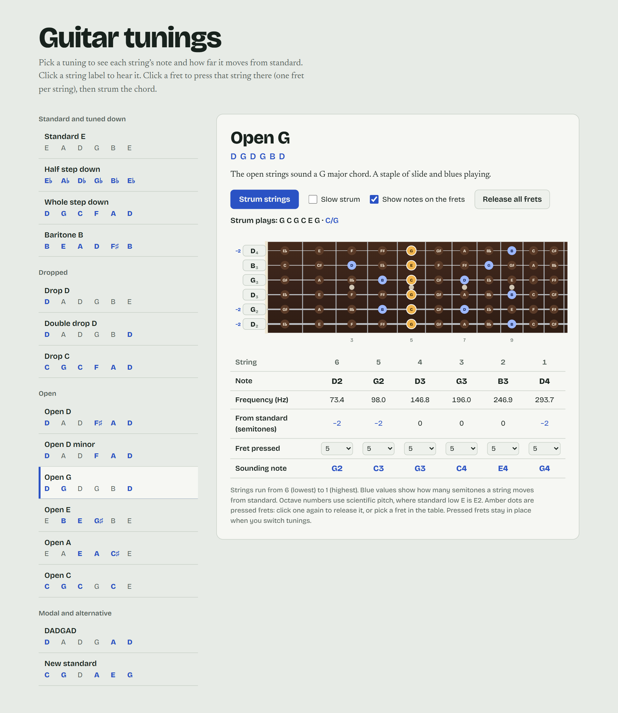

# Guitar tunings

An interactive reference for alternate guitar tunings. Pick a tuning, see each string's note and how far it moves from standard, press frets on a virtual neck, and strum the resulting chord.



It's a single self-contained HTML file with no build step and no dependencies.

## Running it

Open `Guitar tunings.html` in any modern browser. Audio needs a click first (browsers block sound until you interact with the page), so use the buttons or click the neck.

Fonts load from Google Fonts. Offline, the page falls back to system fonts and works the same.

## Features

- **15 tunings** in four groups: standard and tuned down, dropped, open, and modal/alternative (including DADGAD and Robert Fripp's New Standard).
- **Per-string detail:** note and octave, frequency in Hz, and the semitone shift from standard EADGBE. Changed strings are highlighted in blue.
- **Fretboard:** 12 frets, with an optional overlay showing the note at every position. Notes that belong to the open-string chord are highlighted.
- **Fretting:** click a fret to press that string there, and click it again to release it. Each string holds at most one fret, so clicking another fret on the same string moves it. You can also choose frets from the dropdowns in the table, which works from the keyboard.
- **Strum:** plays all six strings as currently fretted. **Slow strum** stretches the gap between strings from 0.09 s to 0.3 s so you can hear each note arrive.
- **Chord name:** shows the sounding notes and names the chord when it's a common type (major, minor, 5, sus, 6, 7, maj7, m7, add9, 9 and a few others), including slash chords like `C/G`. Anything else just lists the notes.
- **Pressed frets carry across tunings**, so you can hear the same shape in a different tuning. **Release all frets** resets them.
- **Deep links:** the selected tuning is stored in the URL hash, e.g. `Guitar tunings.html#dadgad`.
- Follows your system light or dark theme, and works at phone widths.

## How the sound works

There are no audio samples. Each note is synthesised with the Karplus–Strong plucked-string algorithm into a Web Audio buffer, then low-pass filtered. Buffers are cached per note.

## Adding a tuning

Tunings are defined in the `TUNINGS` array in the script. Each one needs an `id`, a `name`, a `desc`, and six MIDI note numbers from the lowest string to the highest (standard is `[40, 45, 50, 55, 59, 64]`). Set `flat: true` to spell notes with flats, then add the `id` to a group in `GROUPS` to show it in the list.

```js
{ id: 'open-d', name: 'Open D', midi: [38,45,50,54,57,62],
  desc: 'Strumming the open strings sounds a D major chord.' }
```
